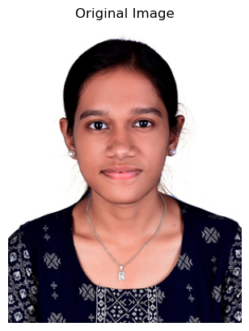

# Image-Handling-and-Pixel-Transformations-Using-OpenCV 

## AIM:
Write a Python program using OpenCV that performs the following tasks:

1) Read and Display an Image.  
2) Adjust the brightness of an image.  
3) Modify the image contrast.  
4) Generate a third image using bitwise operations.

## Software Required:
- Anaconda - Python 3.7
- Jupyter Notebook (for interactive development and execution)

## Algorithm:
### Step 1:
Load an image from your local directory and display it.

### Step 2:
Create a matrix of ones (with data type float64) to adjust brightness.

### Step 3:
Create brighter and darker images by adding and subtracting the matrix from the original image.  
Display the original, brighter, and darker images.

### Step 4:
Modify the image contrast by creating two higher contrast images using scaling factors of 1.1 and 1.2 (without overflow fix).  
Display the original, lower contrast, and higher contrast images.

### Step 5:
Split the image (boy.jpg) into B, G, R components and display the channels

## Program Developed By:
- **Name:** Krithika V
- **Register Number:** 212225040194

  ### Ex. No. 01

#### Step 1: Read and Display the image
```
import cv2
import matplotlib.pyplot as plt

# Read the image using OpenCV
img = cv2.imread('my_image.jpg', cv2.IMREAD_COLOR)

# Convert BGR (OpenCV's default) to RGB (Matplotlib's expected color order)
img_rgb = cv2.cvtColor(img, cv2.COLOR_BGR2RGB)

# Display the image using Matplotlib
plt.imshow(img_rgb, cmap='viridis')  # You can change 'viridis' to another cmap or use None for RGB images
plt.title("Original Image")
plt.axis('off')  # Removes axis ticks and labels
plt.show()
```

#### Step 2: Draw shapes and Add text
#### 2.1: Draw a line
```
# Load the image
image = cv2.imread('my_image.jpg')

# Convert BGR (OpenCV's default) to RGB (Matplotlib's expected color order)
img_rgb = cv2.cvtColor(img, cv2.COLOR_BGR2RGB)

img_rgb.shape

# Draw a line from top-left to bottom-right
line_img = cv2.line(img_rgb, (0, 0), (768, 600), (255, 0, 0), 2) # cv2.line(image, start_point, end_point, color, thickness)

plt.imshow(line_img, cmap='viridis')  
plt.title("Image with Line")
plt.axis('off')  
plt.show()
```

#### 2.2: Draw a circle
```
# Load the image
image = cv2.imread('my_image.jpg') 

# Convert BGR (OpenCV's default) to RGB (Matplotlib's expected color order)
img_rgb = cv2.cvtColor(img, cv2.COLOR_BGR2RGB)

img_rgb.shape

circle_img = cv2.circle(img_rgb,(138,177),100,(255,0,0),5) # cv2.circle(image, center, radius, color, thickness)

plt.imshow(circle_img, cmap='viridis')  
plt.title("Image with Circle")
plt.axis('on')  
plt.show()
```

#### 2.3: Draw a rectangle
```
# Load the original image again
original = cv2.imread('my_image.jpg')

# Convert to RGB
original_rgb = cv2.cvtColor(original, cv2.COLOR_BGR2RGB)

# Make a fresh copy and draw ONLY the blue border
rectangle_img = original_rgb.copy()
h, w = rectangle_img.shape[:2]
cv2.rectangle(rectangle_img, (0, 0), (w-1, h-1), (0, 0, 255), 3)

# Display
plt.figure()
plt.imshow(rectangle_img)
plt.title("Image with Blue Border")
plt.axis('off')
plt.show()
```

#### 2.4: Add text to image
```
# Load the image
image = cv2.imread('my_image.jpg') 

# Convert BGR (OpenCV's default) to RGB (Matplotlib's expected color order)
img_rgb = cv2.cvtColor(img, cv2.COLOR_BGR2RGB)

# Add text to the image
text_img = cv2.putText(img_rgb, "Krithika", (10, 100), cv2.FONT_HERSHEY_SIMPLEX, 1, (255, 0, 0), 3)  ## cv2.putText(image, text, position, font, font_scale, color, thickness)

plt.imshow(text_img, cmap='viridis')  
plt.title("Image with Text")
plt.axis('off')  
plt.show()
```

#### Step 3: Color Space conversion
```
# Load the image
image = cv2.imread('my_image.jpg')

image_rgb = cv2.cvtColor(image, cv2.COLOR_BGR2RGB)

# Original RGB Image
plt.imshow(image_rgb)
plt.title("Original RGB Image")
plt.axis("off")

# Convert RGB to HSV
image_hsv = cv2.cvtColor(image_rgb, cv2.COLOR_RGB2HSV)

# HSV Image
plt.imshow(image_hsv)
plt.title("HSV Image")
plt.axis("off")

# Convert RGB to GRAY
image_gray = cv2.cvtColor(image_rgb, cv2.COLOR_RGB2GRAY)

# Grayscale Image
plt.imshow(image_gray, cmap='gray')
plt.title("Grayscale Image")
plt.axis("off")

# Convert RGB to YCrCb
image_ycrcb = cv2.cvtColor(image_rgb, cv2.COLOR_RGB2YCrCb)

# YCrCb Image
plt.imshow(image_ycrcb)
plt.title("YCrCb Image")
plt.axis("off")

# Convert HSV back to RGB
image_hsv_to_rgb = cv2.cvtColor(image_hsv, cv2.COLOR_HSV2RGB)

plt.imshow(image_hsv_to_rgb)
plt.title("HSV to RGB Image")
plt.axis("off")

```

#### Step 4: Pixel Manipulation
```
img = cv2.imread('my_image.jpg')

# Step 2: Convert BGR to RGB
img_rgb = cv2.cvtColor(img, cv2.COLOR_BGR2RGB)

# Step 3: Create a copy of the original image
block_img = img_rgb.copy()

# Step 4: Draw a filled white block
block_img = cv2.rectangle(
    block_img,
    (0, 0),          # Top-left corner
    (200, 200),      # Bottom-right corner
    (255, 255, 255), # White colour
    -1               # Filled rectangle
)

# Step 5: Display the modified image
plt.imshow(block_img)
plt.title("Image with 300x300 White Block")
plt.axis('off')
plt.show()
```

#### Step 5: Image Resizing
```
# Load the image
image = cv2.imread('my_image.jpg')

image.shape

# Resize the image to half its size
resized_image = cv2.resize(image, (768 // 2, 600 // 2))  # (new_width, new_height)

# Convert BGR to RGB for displaying with Matplotlib
resized_image_rgb = cv2.cvtColor(resized_image, cv2.COLOR_BGR2RGB)

resized_image_rgb.shape

# Display the resized image
plt.imshow(resized_image_rgb)
plt.title("Resized Image (Half Size)")
plt.axis("off")
plt.show()
```

#### Step 6: Image cropping
```
# Load the image
image = cv2.imread('my_image.jpg')

image.shape

# Crop a 300x300 region starting from (50, 50)
roi = image[50:350, 50:350]  # Rows: 50-349, Columns: 50-349

# Convert BGR to RGB for displaying with Matplotlib
roi_rgb = cv2.cvtColor(roi, cv2.COLOR_BGR2RGB)

# Display the cropped region (ROI)
plt.imshow(roi_rgb)
plt.title("Cropped Region of Interest (ROI)")
plt.axis("off")
plt.show()
```

#### Step 7: Image Flipping
```
# Load the image
image = cv2.imread('my_image.jpg')

# Flip the image horizontally (left-right)
flipped_horizontally = cv2.flip(image, 1)

# Convert BGR to RGB for displaying with Matplotlib
flipped_horizontally_rgb = cv2.cvtColor(flipped_horizontally, cv2.COLOR_BGR2RGB)

# Horizontal flip
plt.imshow(flipped_horizontally_rgb)
plt.title("Flipped Horizontally")
plt.axis("off")

# Flip the image vertically (up-down)
flipped_vertically = cv2.flip(image, 0)

# Convert BGR to RGB for displaying with Matplotlib
flipped_vertically_rgb = cv2.cvtColor(flipped_vertically, cv2.COLOR_BGR2RGB)

# Vertical flip
plt.imshow(flipped_vertically_rgb)
plt.title("Flipped Vertically")
plt.axis("off")
```

## Output:



## Result:
Thus, the images were read, displayed, brightness and contrast adjustments were made, and bitwise operations were performed successfully using the Python program.

